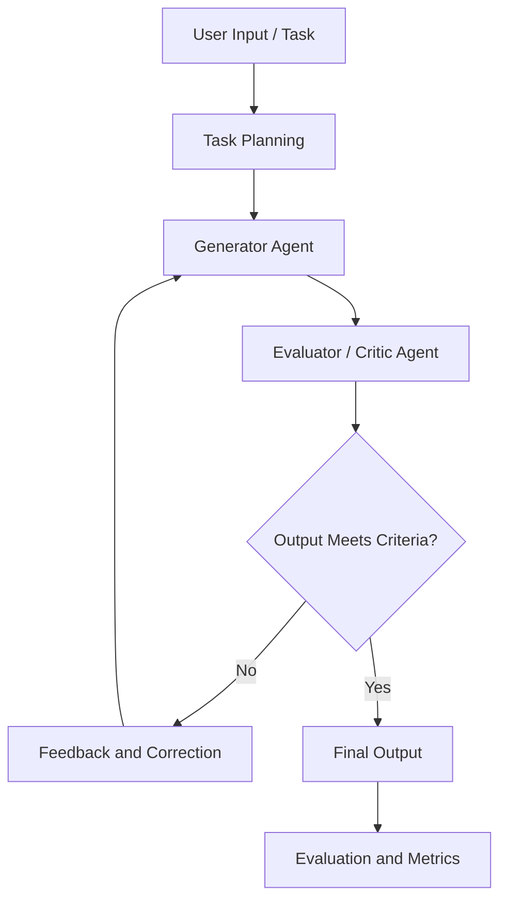

# Self-Correcting Multi-Agent System

An Agentic AI system designed to explore how multiple AI agents can collaborate, evaluate outputs, identify errors, and iteratively improve results through a structured feedback loop.

## Overview

Large Language Models (LLMs) can generate useful responses, but their outputs may contain logical errors, incomplete reasoning, or incorrect information. A single-pass generation process does not always detect these problems.

The **Self-Correcting Multi-Agent System** explores a more reliable approach by organizing AI tasks into multiple stages, where generated outputs can be reviewed, evaluated, and refined before producing a final result.

The project focuses on agent collaboration, iterative refinement, output verification, and measurable evaluation.

## Key Objectives

- Explore multi-agent orchestration for complex AI tasks.
- Implement a structured generate–evaluate–correct workflow.
- Identify potential errors in AI-generated outputs.
- Improve output quality through feedback-driven refinement.
- Evaluate system performance using repeatable test scenarios.
- Investigate reliability, hallucination risks, and task-completion performance.

## System Workflow

The conceptual workflow is:



The workflow represents the intended architecture. The agents, validation criteria, and iteration limits depend on the actual implementation.

### Workflow Stages

1. **Task Input:** Receive the task or problem to solve.
2. **Generation:** Produce an initial response or solution.
3. **Evaluation:** Examine the output against defined criteria.
4. **Feedback:** Identify potential errors or missing requirements.
5. **Correction:** Refine the output using evaluator feedback.
6. **Finalization:** Return the result when the acceptance criteria are met or the iteration limit is reached.
7. **Evaluation:** Record relevant performance metrics for analysis.

## Why Self-Correction?

| Traditional LLM Workflow | Self-Correcting Workflow |
|---|---|
| Generates an output in one pass | Supports iterative refinement |
| May return errors without review | Introduces an evaluation stage |
| Limited feedback within the same task | Can use feedback to revise outputs |
| Quality may be difficult to measure | Can be evaluated with defined metrics |

Self-correction does not guarantee that an answer is correct. Its effectiveness depends on the evaluator's quality, verification methods, available evidence, and stopping conditions.

## Evaluation Metrics

The system can be evaluated using the following metrics:

| Metric | Purpose |
|---|---|
| Task Completion Rate | Measures the percentage of tasks completed successfully |
| Correction Success Rate | Measures how often an unsuccessful initial output is corrected successfully |
| Output Quality | Assesses results against predefined task-specific criteria |
| Hallucination Rate | Measures unsupported or factually incorrect claims using a defined evaluation method |
| Average Response Latency | Measures the time required to complete a task |
| Iterations per Task | Measures how many refinement cycles are required |

Metrics should be calculated from recorded test results rather than assumed from individual successful runs.

## Technology Stack

The exact stack should reflect the libraries and models used in the implementation.

Potential components include:

- **Python** — core application logic
- **Large Language Models (LLMs)** — response generation and evaluation
- **Agent Orchestration** — coordinating agent roles and workflow transitions
- **Automated Testing** — validating outputs against expected results
- **Evaluation Dashboard** — visualizing performance metrics, if implemented

## Getting Started

### Prerequisites

- Python 3.10 or a compatible version supported by the project dependencies
- Git
- Access to the model provider configured by the implementation
- Required Python packages

### 1. Clone the repository

```bash
git clone https://github.com/konjetisohith/Self-Correcting.git
cd Self-Correcting
```

### 2. Create a virtual environment

**Windows:**

```bash
python -m venv .venv
.venv\Scripts\activate
```

**Linux / macOS:**

```bash
python3 -m venv .venv
source .venv/bin/activate
```

### 3. Install dependencies

If the project contains a `requirements.txt` file:

```bash
pip install -r requirements.txt
```

If dependencies are managed differently, follow the configuration provided in the project.

### 4. Configure environment variables

If the application requires API credentials, configure them using the environment-variable names expected by the code.

Keep API keys in a local `.env` file or environment variables. Never commit secrets to GitHub.

### 5. Run the application

Use the entry-point script or command specified by the project. For example, if the application uses `main.py`:

```bash
python main.py
```

The entry-point filename and launch command must match the actual repository structure.

## Testing and Benchmarking

A useful evaluation process should include:

1. Prepare a collection of representative test cases.
2. Record each task's initial output.
3. Evaluate the initial output against a defined acceptance criterion.
4. Record whether feedback leads to a successful correction.
5. Measure latency and the number of refinement iterations.
6. Compare initial and final results across the same test cases.

For meaningful comparisons, use consistent test inputs, explicit success criteria, and reproducible evaluation conditions.

## Limitations

- An evaluator can make mistakes or approve an incorrect output.
- Repeated refinement can increase latency and model usage.
- Results depend on model capability and task complexity.
- Evaluation metrics require clearly defined criteria.
- Self-correction alone does not eliminate hallucinations.

## Future Improvements

- Add larger and more diverse benchmark datasets.
- Compare different models and evaluation strategies.
- Add structured output validation and automated test execution.
- Introduce maximum iteration limits and failure handling.
- Track correction success, latency, and resource consumption.
- Add traceable execution logs and a results dashboard.
- Evaluate performance against a single-pass baseline.

## Project Structure

The repository contains a `MULTI AGENT LOOP SYSTEM` directory. Refer to the actual files inside that directory for implementation details and execution instructions.

## Author

**Konjeti Sohith**

- GitHub: [@konjetisohith](https://github.com/konjetisohith)


